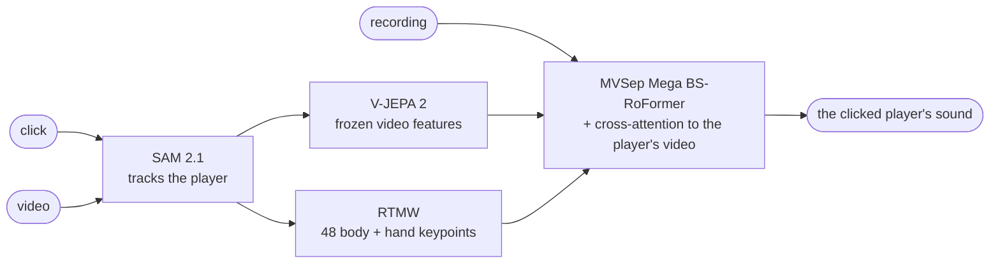

<div align="center">

# Who Plays What

### Click-Promptable Per-Player Music Separation from Video

Abhinaba Roy<sup>1</sup>, Ambuj Mehrish<sup>2</sup>, Sebastiano Vascon<sup>2</sup>, Dorien Herremans<sup>1</sup>

<sup>1</sup> Singapore University of Technology and Design &nbsp;&nbsp; <sup>2</sup> University of Venice

[](#citation)
[](https://amaai-lab.github.io/who_plays_what_demo/)
[](https://huggingface.co/amaai-lab/who_plays_what)
[](https://huggingface.co/datasets/amaai-lab/who_plays_what)
[](LICENSE)
[](https://creativecommons.org/licenses/by-nc/4.0/)

</div>

**Click on one musician in a video and hear only that musician**, even when another player of the *same instrument*
plays at the same time.

Two violinists sound alike and look alike, so neither audio-only separators nor appearance-based audio-visual models
can tell them apart. What differs is *what each player does, and when*. Who Plays What reads the clicked player's
movement and uses it to pull their part out of the recording.

## Results

URMP, real ensemble recordings. SDR in dB (museval, the MUSDB18 standard; **higher is better**) of the output against the clicked
player's true track, median over 58 clicked players. Each of them plays alongside another player of the same instrument.

| Method | All (58) | Strings (28) | Winds & brass (30) | Same-instrument duets (8) |
|---|:-:|:-:|:-:|:-:|
| Recording, unprocessed | -6.29 | -6.71 | -5.77 | 0.00 |
| Recording / number of players | 0.82 | 0.73 | 1.02 | 2.91 |
| SAM Audio (video prompt) | -3.92 | -3.97 | -3.73 | -0.20 |
| iQuery | -0.45 | -0.62 | -0.12 | 0.29 |
| DAVIS-Flow | 0.01 | 0.01 | 0.01 | 0.02 |
| MVSep Mega (audio only, instrument stem) | 0.30 | 0.43 | 0.30 | 1.75 |
| **Who Plays What (ours)** | **5.30** | **6.20** | **3.62** | **18.73** |

The model is trained only on artificial mixes of solo YouTube performances. URMP is never seen in training.

## How it works



* **Prompt.** One click on the player, like SAM's point prompt. SAM 2.1 follows them through the video.
* **Video.** A frozen V-JEPA 2 ViT-L grid of the player's crop (12.5 / s), plus box-normalised velocities of 48 body
  and hand keypoints (25 / s). Every token carries its time, so audio and video line up without resampling.
* **Separator.** MVSep Mega's pretrained BS-RoFormer trunk (band split and 12 blocks). After every time transformer, a
  cross-attention layer reads the player's video tokens. A complex-mask head gives the player's spectrogram.
* **Training.** Fake mixes of solo clips (Solos + MUSIC-21, 26 instruments). The clicked player is mixed with a
  different instrument, the same instrument from another video, a pitch / tempo-matched one, or *the same video at
  another moment* (same person and room, only the timing differs), plus 0-3 other instruments. Each player's video is
  mirrored half the time.

## Installation

```bash
git clone https://github.com/AMAAI-Lab/who_plays_what.git && cd who_plays_what
conda create -n whoplays python=3.11 -y && conda activate whoplays
pip install -r requirements.txt
```

You also need `ffmpeg` (and `node`, only to download the training videos with yt-dlp). Run every command from the
repository root. Paths are set in [`config.yaml`](config.yaml).

Download the trained model and the SAM 2.1 checkpoint into `checkpoints/`:

```bash
hf download amaai-lab/who_plays_what --local-dir checkpoints
wget -P checkpoints https://dl.fbaipublicfiles.com/segment_anything_2/092824/sam2.1_hiera_large.pt
```

V-JEPA 2 and RT-DETRv2 download from Hugging Face on first use, and RTMW downloads through rtmlib.

## Separate a player in your own video

```bash
python -m whoplays.separate video --video concert.mp4 --click 640,360 --click 1200,380 --out out/
```

Give one `--click x,y` per player, in the video's pixels. The command writes `out/player_<k>.wav` for each click.
A few points on the same player track more reliably than one, e.g. head, chest and hips:
`--click "640,200;640,330;640,460"`. Check the tracking in `cache/videos/<video name>/overlay.jpg`.

## Evaluate on URMP

1. Download [URMP](https://doi.org/10.5061/dryad.ng3r749) and unpack it so that `data/URMP/Dataset` holds its pieces.
2. Optionally, download our precomputed URMP player features. Without them, step 3 tracks the players and extracts
   the features itself.

   ```bash
   hf download amaai-lab/who_plays_what --repo-type dataset --include "urmp/*" --local-dir data/hf
   mkdir -p cache/videos && cp -r data/hf/urmp/* cache/videos/
   ```

3. Separate every clicked player, then score:

   ```bash
   python -m whoplays.urmp                                                          # index of the 29 pairs
   CUDA_VISIBLE_DEVICES=i python -m whoplays.separate urmp --name ours --shard i/4  # i = 0..3, one per GPU
   python -m whoplays.evaluate ours
   ```

The clicks are in [`assets/urmp_clicks.json`](assets/urmp_clicks.json): three points (nose, shoulders, hips) per player,
checked by hand.

## Training

### Data

The training videos come from YouTube ([Solos](https://github.com/JuanFMontesinos/Solos) and
[MUSIC-21](https://github.com/roudimit/MUSIC_dataset)), so we release only their ids and timestamps. Our
[dataset on Hugging Face](https://huggingface.co/datasets/amaai-lab/who_plays_what) lists the 42,019 training and
validation clips (YouTube id, instrument, start time, split). Download the videos, then compute the features of exactly
these clips:

```bash
# place MUSIC21_solo_videos.json from the MUSIC-21 repository in data/solos first
python -m whoplays.solos download                                       # videos from YouTube
hf download amaai-lab/who_plays_what --repo-type dataset --include "solos/*" --local-dir data/hf
mkdir -p cache/solos && cp data/hf/solos/split.json cache/solos/
CUDA_VISIBLE_DEVICES=i python -m whoplays.solos clips --list data/hf/solos/clips.csv --shard i/4   # keypoints, one per GPU
CUDA_VISIBLE_DEVICES=i python -m whoplays.vjepa --shard i/4             # V-JEPA 2 features
CUDA_VISIBLE_DEVICES=i python -m whoplays.vjepa --flip --shard i/4      # the same, mirrored
```

Clips from videos that are no longer on YouTube are skipped. The keypoint statistics (`checkpoints/stats.npz`) come
with the model download.

<details>
<summary>Or pick new clips and a new split</summary>

```bash
CUDA_VISIBLE_DEVICES=i python -m whoplays.solos clips --shard i/4      # 4 s clips with a player in view + keypoints
python -m whoplays.solos split                                         # train / val / test / excluded
python -m whoplays.solos stats                                         # keypoint normalisation
```

`split` leaves out the MUSIC / MUSIC-21 benchmark test videos. Set `paths.benchmark_lists` to the test lists of
[iQuery](https://github.com/JiabenChen/iQuery) (`data/MUSIC*/test*.csv`) and [DAVIS](https://github.com/WikiChao/DAVIS)
(`data/Music/test*.csv`).

</details>

### Pretrained trunk

Training starts from the MVSep Mega 53-stem BS-RoFormer by ZFTurbo ([MVSep](https://mvsep.com),
[Music-Source-Separation-Training v1.0.21](https://github.com/ZFTurbo/Music-Source-Separation-Training/releases/tag/v1.0.21)).
Its config, `checkpoints/mega53.yaml`, comes with our model download; download its weights (1.4 GB):

```bash
wget -O checkpoints/mega53.ckpt https://github.com/ZFTurbo/Music-Source-Separation-Training/releases/download/v1.0.21/mvsep_mega_model_bs_roformer_53_stems_v1.ckpt
# sha256: c62820893bbf86d4e734f966bd142d9157cfc8bb8e79e9d8f9ea553f3ff3519f
```

### Run

```bash
torchrun --nproc_per_node 4 -m whoplays.train --name ours
```

Batch 8 per GPU (about 70 GB each), AdamW 3e-4, 1k warmup, cosine over 52k steps. Training stops early after 5
validations without improvement. The best checkpoint goes to `ckpt/ours.pt` and the validation curve to `logs/ours.csv`.
Our model took about 14 h on 4 RTX PRO 6000 GPUs (best at step 37k). Evaluate a new model with `--ckpt ckpt/ours.pt`.

## Repository

| File | |
|---|---|
| `whoplays/model.py` | the separator |
| `whoplays/train.py` | training |
| `whoplays/separate.py` | inference on any video and on URMP |
| `whoplays/pairs.py` | training and validation mixes |
| `whoplays/solos.py` | training data: download, clip index, split, keypoint statistics |
| `whoplays/video.py` | frames, SAM 2.1 tracking from clicks, player boxes |
| `whoplays/pose.py` | RTMW keypoints of a player |
| `whoplays/vjepa.py` | V-JEPA 2 features of a player's crop |
| `whoplays/urmp.py`, `evaluate.py`, `score.py` | URMP evaluation |
| `whoplays/bs_roformer/` | BS-RoFormer from ZFTurbo's Music-Source-Separation-Training (MIT) |

## Citation

```bibtex
@article{whoplayswhat,
  title   = {Who Plays What: Click-Promptable Per-Player Music Separation from Video},
  author  = {Roy, Abhinaba and Mehrish, Ambuj and Vascon, Sebastiano and Herremans, Dorien},
  journal = {arXiv preprint arXiv:XXXX.XXXXX},
  year    = {2026}
}
```

## License

The code is released under the [MIT License](LICENSE). The model weights and the dataset are released under
[CC BY-NC 4.0](https://creativecommons.org/licenses/by-nc/4.0/). They build on MVSep Mega, V-JEPA 2, SAM 2.1, RTMW,
Solos, MUSIC-21 and URMP; please also respect their licenses.

## Acknowledgements

[BS-RoFormer / Music-Source-Separation-Training](https://github.com/ZFTurbo/Music-Source-Separation-Training),
[MVSep](https://mvsep.com), [SAM 2](https://github.com/facebookresearch/sam2),
[V-JEPA 2](https://github.com/facebookresearch/vjepa2), [rtmlib](https://github.com/Tau-J/rtmlib),
[museval](https://github.com/sigsep/sigsep-mus-eval), [URMP](https://labsites.rochester.edu/air/projects/URMP.html),
[Solos](https://github.com/JuanFMontesinos/Solos), [MUSIC](https://github.com/roudimit/MUSIC_dataset).
